# 💅 BeautyFlow — Plataforma Inteligente de Gestão & Agendamento para Estúdios de Beleza

> **Projeto de Extensão Universitária — SENAI**  
> Uma solução completa, visual e acolhedora feita para simplificar a rotina de manicures, nail designers, salões e profissionais de estética.

---

## 🌸 O que é o BeautyFlow?

O **BeautyFlow** foi criado para resolver as dores reais do dia a dia de quem trabalha com beleza: mensagens acumuladas no WhatsApp, horários anotados em papéis ou cadernos, esquecimento de clientes, falta de controle financeiro e materiais acabando sem aviso prévio.

A plataforma une dois ambientes em perfeita harmonia:
1. 🌸 **Portal de Agendamento Online da Cliente:** Um link fácil e elegante para sua cliente escolher o serviço e o melhor horário direto pelo celular ou computador.
2. 📊 **Painel de Gestão (CRM) da Profissional:** Uma central completa para acompanhar a agenda do dia, cadastros das clientes, estoque, receitas, despesas e metas mensais.
3. 🤖 **Secretária Virtual no WhatsApp:** Envio automático de confirmações, lembretes de horário na véspera do atendimento e avisos para retorno de manutenção.

Tudo acontece em **tempo real**: assim que a cliente confirma o horário no portal, o painel do estúdio atualiza sozinho e avisa a profissional!

---

## 📋 Sumário Rápido

* [✨ Principais Benefícios](#-principais-benefícios)
* [📱 1. O Portal de Agendamento (Visão da Cliente)](#-1-o-portal-de-agendamento-visão-da-cliente)
* [📊 2. Painel Geral (Dashboard)](#-2-painel-geral-dashboard)
* [📅 3. Agenda Semanal & Horários](#-3-agenda-semanal--horários)
* [👥 4. Gestão & Ficha das Clientes](#-4-gestão--ficha-das-clientes)
* [💅 5. Catálogo de Procedimentos & Preços](#-5-catálogo-de-procedimentos--preços)
* [📦 6. Controle de Estoque & Materiais](#-6-controle-de-estoque--materiais)
* [💰 7. Gestão Financeira & Metas](#-7-gestão-financeira--metas)
* [📈 8. Relatórios de Desempenho & Emissão em PDF](#-8-relatórios-de-desempenho--emissão-em-pdf)
* [💬 9. WhatsApp Automático & Robô de Mensagens](#-9-whatsapp-automático--robô-de-mensagens)
* [⚙️ 10. Configurações, Equipe & Personalização](#-10-configurações-equipe--personalização)
* [🚀 Como Executar o Sistema](#-como-executar-o-sistema)
* [🛠️ Tecnologias Utilizadas](#️-tecnologias-utilizadas)
* [📄 Licença](#-licença)

---

## ✨ Principais Benefícios

| Para a Cliente | Para a Profissional | Para o Negócio |
|---|---|---|
| Autoatendimento 24 horas por dia | Fim dos conflitos de horário e furos na agenda | Aumento de até 35% no comparecimento com lembretes automáticos |
| Sem necessidade de baixar aplicativos | Controle total de quanto faturou e quanto gastou | Fidelização de clientes com mensagens de retorno |
| Escolha visual de serviços e preços | Alerta automático quando materiais estão acabando | Relatórios profissionais prontos para tomada de decisão |

---

## 📱 1. O Portal de Agendamento (Visão da Cliente)

A cliente acessa o link do seu estúdio e é recebida por uma assistente virtual humanizada. Ela digita apenas o nome e o WhatsApp para começar:

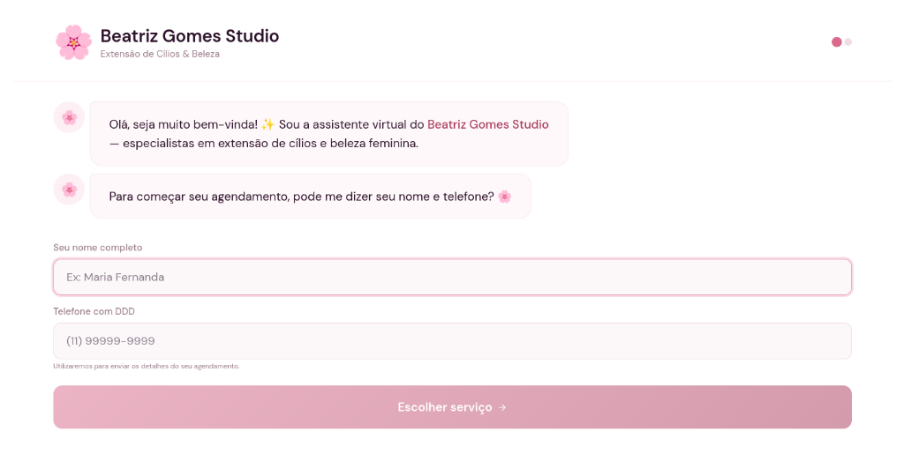

Em seguida, o catálogo de procedimentos é exibido de forma visual com valores, duração de cada procedimento e o tempo de intervalo. A cliente escolhe a data e os horários livres são calculados automaticamente para evitar qualquer choque de horário:

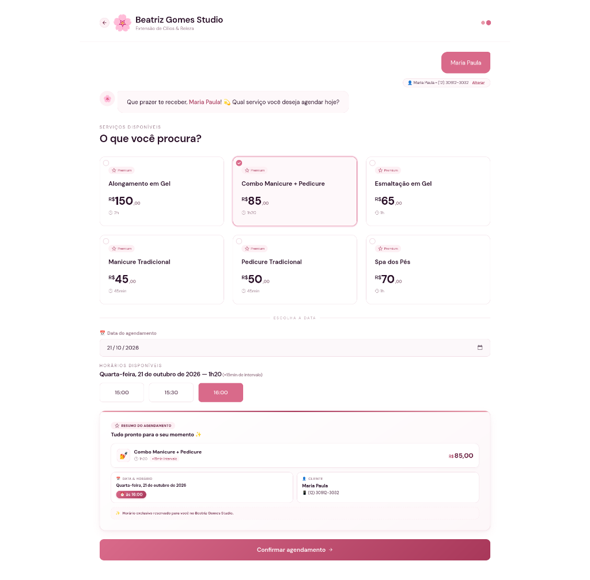

> **💡 Vantagem:** Sem estresse de mensagens demoradas para achar um horário vago. A cliente agenda em menos de 1 minuto!

---

## 📊 2. Painel Geral (Dashboard)

Ao abrir o CRM, a dona do estúdio tem um raio-X completo do seu dia e do seu mês:
* **Entradas do Dia:** Quanto entrou no caixa hoje.
* **Atendimentos:** Quantidade de clientes agendadas para hoje e total do mês.
* **Clientes Ativos:** Quantidade de clientes cadastradas que frequentam o espaço.
* **Ticket Médio:** Valor médio que cada cliente gasta por visita.
* **Agendamentos de Hoje:** Lista com nome, procedimento, valor e status de pagamento.
* **Fluxo de Caixa & Metas:** Acompanhamento em barra de progresso da meta financeira mensal.

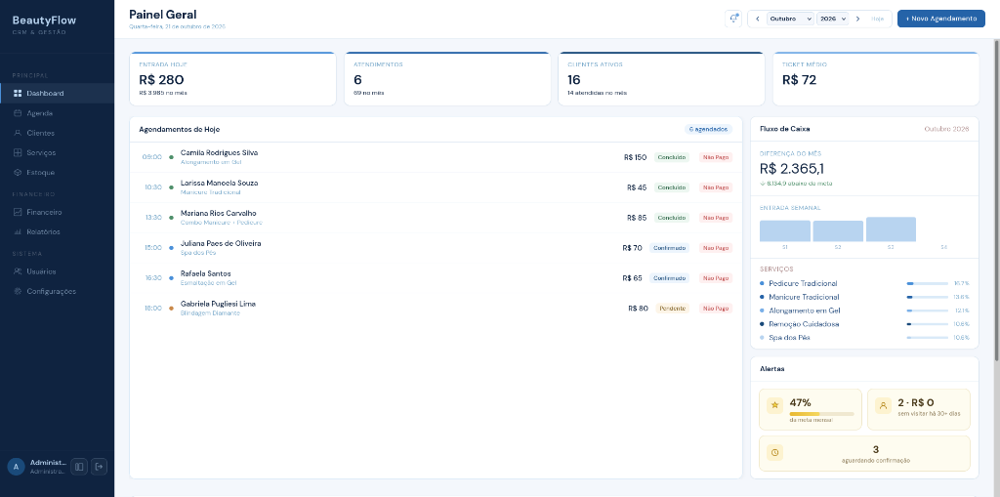

---

## 📅 3. Agenda Semanal & Horários

A agenda semanal permite visualizar os atendimentos em blocos coloridos e organizados por status:
* 🟢 **Concluído:** Atendimento realizado com sucesso.
* 🔵 **Confirmado:** Horário garantido com a cliente.
* 🟡 **Pendente:** Aguardando confirmação ou pagamento prévio.
* 🔴 **Cancelado / Vago:** Horário liberado para novas reservas.

Também é possível identificar na hora se o procedimento já foi pago ou se está pendente de recebimento:

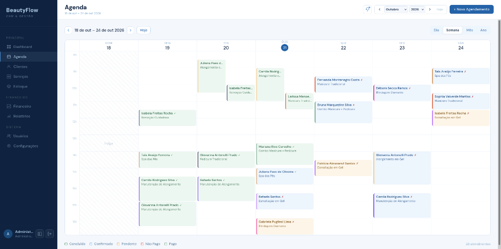

---

## 👥 4. Gestão & Ficha das Clientes

Uma lista inteligente onde cada cliente possui sua própria ficha personalizada:
* Histórico completo de visitas e quanto já investiu no estúdio.
* Classificação automática: `Frequente`, `Regular`, `Novo`, `Inativo` ou `Inadimplente`.
* Anotações exclusivas de cada cliente (ex: formato de unha preferido, alergias a produtos convencionais, preferências de cores e café).
* Botão para abrir o WhatsApp da cliente com apenas 1 clique.

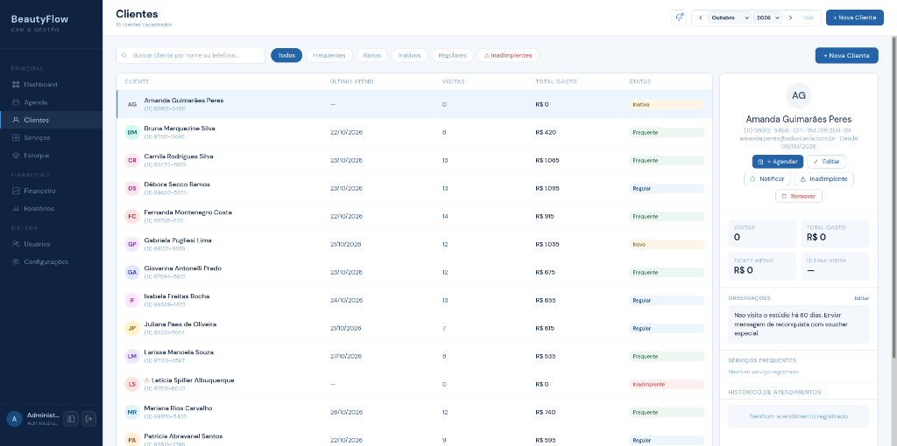

---

## 💅 5. Catálogo de Procedimentos & Preços

Cadastre e edite facilmente todos os serviços oferecidos no estúdio com:
* Nome do procedimento (ex: *Alongamento em Gel, Blindagem Diamante, Spa dos Pés, Esmaltação em Gel*).
* Duração estimada de atendimento.
* Intervalo entre atendimentos (tempo para higienização e esterilização de materiais).
* Valor cobrado e cor identificadora para a agenda.

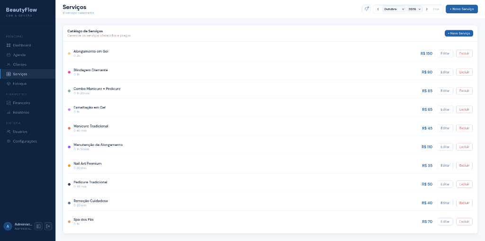

---

## 📦 6. Controle de Estoque & Materiais

Nunca mais fique sem esmaltes, algodão, luvas ou brocas no meio de um atendimento!
* **Patrimônio em Mercadorias:** Valor total em reais investido em produtos no estúdio.
* **Alerta de Estoque Baixo:** Aviso automático quando o item atinge a quantidade mínima de segurança.
* **Lista de Reposição Rápida:** Botão `+ Repor` para atualizar a quantidade recebida com rapidez.

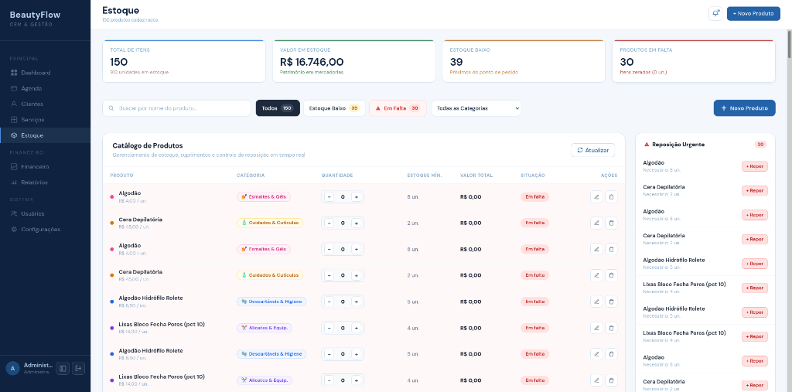

---

## 💰 7. Gestão Financeira & Metas

Tenha clareza absoluta da saúde financeira do seu espaço:
* **Entradas vs. Saídas:** Gráficos semanais comparando receitas e custos operacionais.
* **Faturamento por Serviço:** Descubra quais procedimentos trazem maior retorno para o seu negócio.
* **Despesas por Categoria:** Aluguel, contas de luz/internet, compra de esmaltes e materiais descartáveis.
* **Acompanhamento de Metas:** Defina o objetivo financeiro do mês e acompanhe o percentual atingido dia a dia.

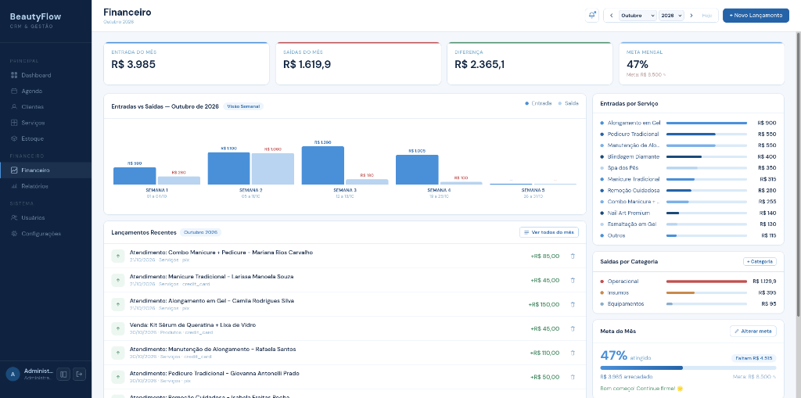

---

## 📈 8. Relatórios de Desempenho & Emissão em PDF

Informações estratégicas transformadas em gráficos simples de entender:
* **Top Clientes:** Quem são suas clientes mais fiéis e lucrativas.
* **Serviços Mais Populares:** Os procedimentos mais pedidos no mês.
* **Mapa de Calor (Horários de Pico):** Descubra quais dias e horários têm maior procura para planejar promoções ou folgas da equipe.

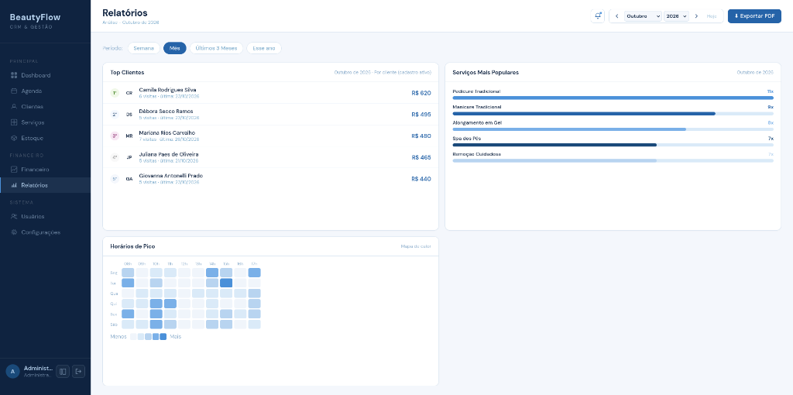

### 📄 Relatório Gerencial em PDF
Com um clique no botão **Exportar PDF**, o sistema gera um documento limpo e profissional contendo os dados cadastrais da empresa (Razão Social, CNPJ, Inscrição Municipal e Endereço) pronto para contabilidade ou prestação de contas:

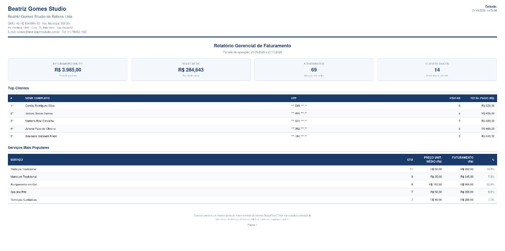

---

## 💬 9. WhatsApp Automático & Robô de Mensagens

O BeautyFlow conta com integração nativa com o WhatsApp via microserviço WAHA, permitindo que o estúdio opere com mensagens automáticas sem precisar digitar a mesma coisa o dia todo:

### 🟢 Status de Conexão em Tempo Real
Conexão estável e monitorada por QR Code, com gatilhos rápidos de notificação ativados:

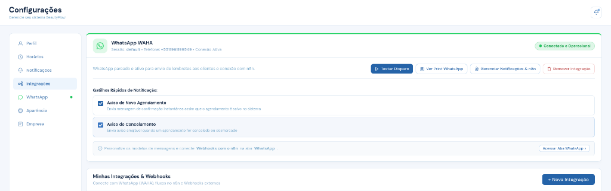

### 🤖 Modelos de Mensagens (Templates) & Integração com n8n
Configure as mensagens automáticas com tags dinâmicas como `{nome}`, `{servico}`, `{data}` e `{horario}`:
1. **Confirmação Imediata:** Enviada logo após a cliente agendar pelo portal.
2. **Lembrete de Horário (24h antes):** Reduz esquecimentos e faltas.
3. **Aviso de Cancelamento:** Notificação amigável e acolhedora.
4. **Retorno e Manutenção:** Convite automático para manutenção após 20 a 25 dias.
5. **Agradecimento Pós-Atendimento:** Fidelização e pedido de avaliação.
6. **Integração n8n:** Webhooks prontos para disparar fluxos avançados ou sincronizar com o Google Calendar.

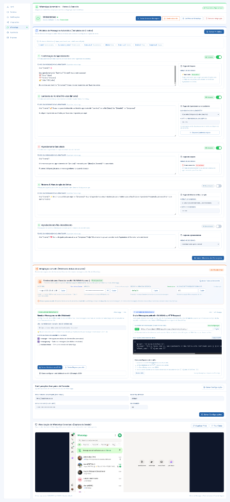

---

## ⚙️ 10. Configurações, Equipe & Personalização

### 👥 Equipe e Colaboradoras
Controle de acessos com níveis de permissão diferentes para administradoras e nail designers/atendentes:

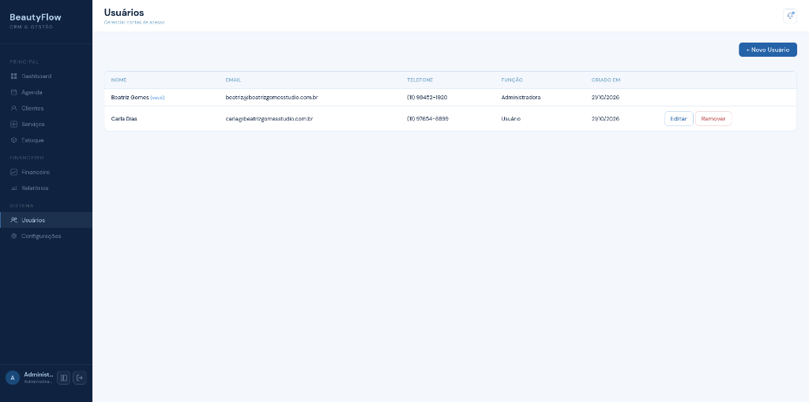

---

### ⏰ Horários de Funcionamento
Defina os dias de abertura e fechamento, turnos matutinos e vespertinos, e dias de folga:

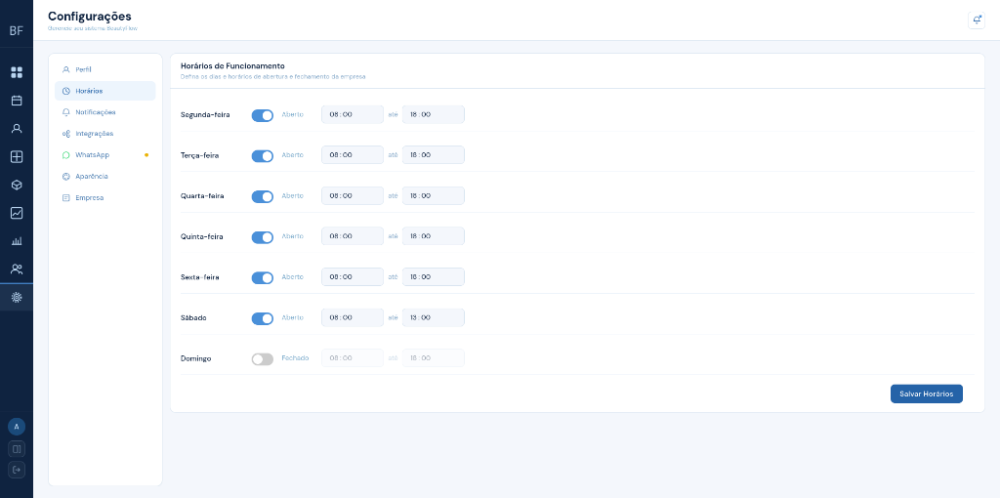

---

### 🔔 Notificações e Automações
Ative ou desative os lembretes automáticos, confirmações de pagamento via Pix e alertas de metas através de interruptores simples:

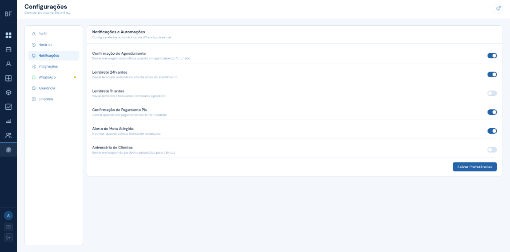

Central de alertas instantâneos no ícone de sino:

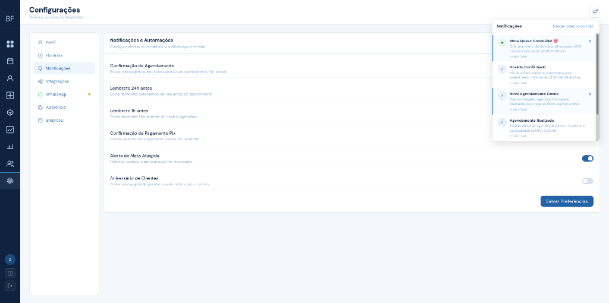

---

### 🔌 Conexão de Integrações & Webhooks
Adicione integrações externas para enviar dados para ferramentas de automação (n8n, Make ou Webhooks próprios):

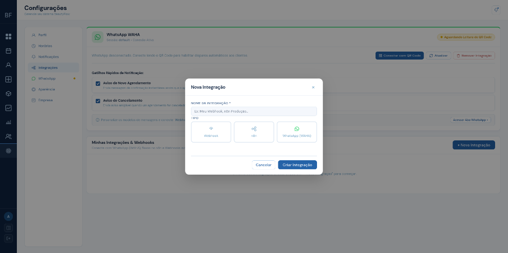

---

### 🎨 Personalização de Aparência & Temas
Escolha a identidade visual que mais combina com o seu estúdio:
* **5 Paletas de Cores:** *Azul Padrão, Esmeralda, Rosa Beauty, Púrpura e Luz do Sol*.
* **Ajuste de Tipografia:** Tamanho de fontes Pequeno, Médio ou Grande.
* **Modo de Exibição:** Modo Claro ou Modo Escuro relaxante para os olhos.

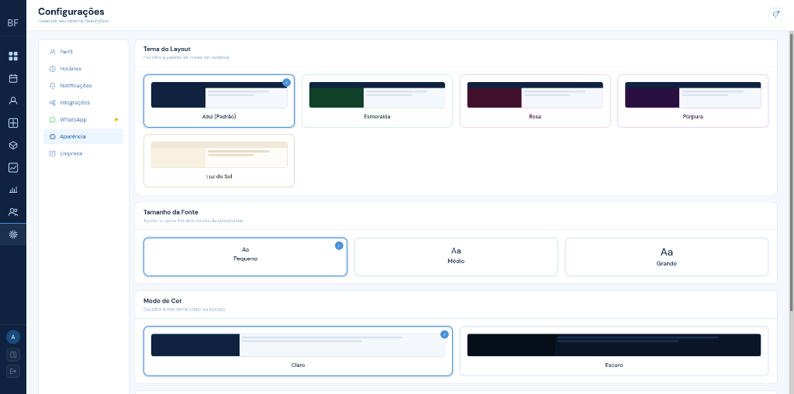

---

### 🏢 Informações Oficiais da Empresa
Preencha a Razão Social, CNPJ, Inscrição Municipal e Endereço para saírem automaticamente em orçamentos e relatórios em PDF:

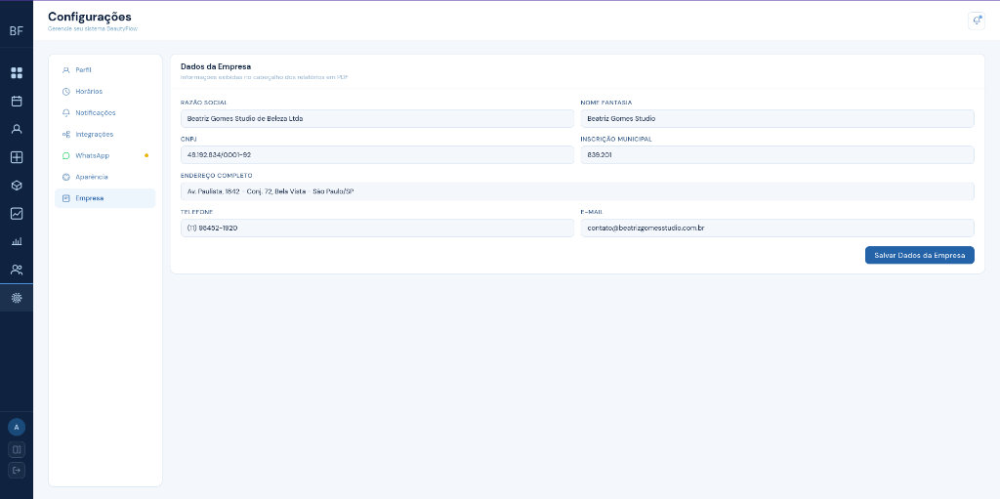

---

## 🚀 Como Executar o Sistema

Você pode rodar todo o ecossistema com **apenas 1 comando** no Linux ou macOS:

### 1. Clonar o Repositório
```bash
git clone https://github.com/SEU_USUARIO/Extensao_universitaria_Manicure.git
cd Extensao_universitaria_Manicure
```

### 2. Iniciar o Ambiente de Desenvolvimento
```bash
./dev.sh
```

O script cuidará de tudo automaticamente:
* Inicia o banco de dados **PostgreSQL** no Docker.
* Conecta a integração do **WhatsApp WAHA**.
* Inicia o **CRM BeautyFlow** (Backend em Rust na porta `3001`).
* Inicia o **Portal de Agendamento da Cliente** (Vite na porta `5173`).

### 🌐 Endereços de Acesso:
* 📊 **Painel CRM da Profissional:** [http://localhost:3001](http://localhost:3001)  
  * **Usuário:** `admin` | **Senha:** `admin`
* 🌸 **Portal de Agendamento Online:** [http://localhost:5173](http://localhost:5173)
* 📱 **WhatsApp WAHA (QR Code):** [http://localhost:3000/dashboard](http://localhost:3000/dashboard)

> **💡 Dica:** Para rodar sem o serviço de WhatsApp, execute: `./dev.sh --no-waha`

---

## 🛠️ Tecnologias Utilizadas

Para garantir que o sistema seja **ultrarrápido**, seguro e consuma o mínimo possível de memória da máquina, utilizamos tecnologias modernas de ponta:

* **Backend Principal (Rust Nativo):** Desenvolvido em **Rust 1.80+** com **Axum 0.8** e **Tokio**, entregando respostas em menos de 1 milissegundo e consumindo apenas ~16MB de memória RAM.
* **Comunicação em Tempo Real:** **WebSockets (Socket.IO v4)** para atualização imediata da agenda quando a cliente reserva um horário.
* **Frontend da Profissional (CRM):** Construído em **HTML5**, **CSS3 moderno** e **JavaScript modular** sem frameworks pesados, garantindo carregamento instantâneo.
* **Frontend da Cliente (Portal):** Desenvolvido em **React 19**, **Vite** e **Tailwind CSS 4**, totalmente responsivo e pensado para celular.
* **Banco de Dados:** **PostgreSQL 16** para segurança dos dados cadastrais e financeiros, e **SQLite 3** dedicado para o histórico de conversas do WhatsApp.
* **Infraestrutura:** **Docker & Docker Compose** para instalação e execução simplificadas.

---

## 📄 Licença

Este projeto foi desenvolvido como parte das atividades de Extensão Universitária do **SENAI**, voltado ao apoio comunitário e capacitação tecnológica para empreendedores do setor de beleza.

Distribuído sob a licença **MIT**. Sinta-se livre para usar, estudar e evoluir a plataforma! 💖
